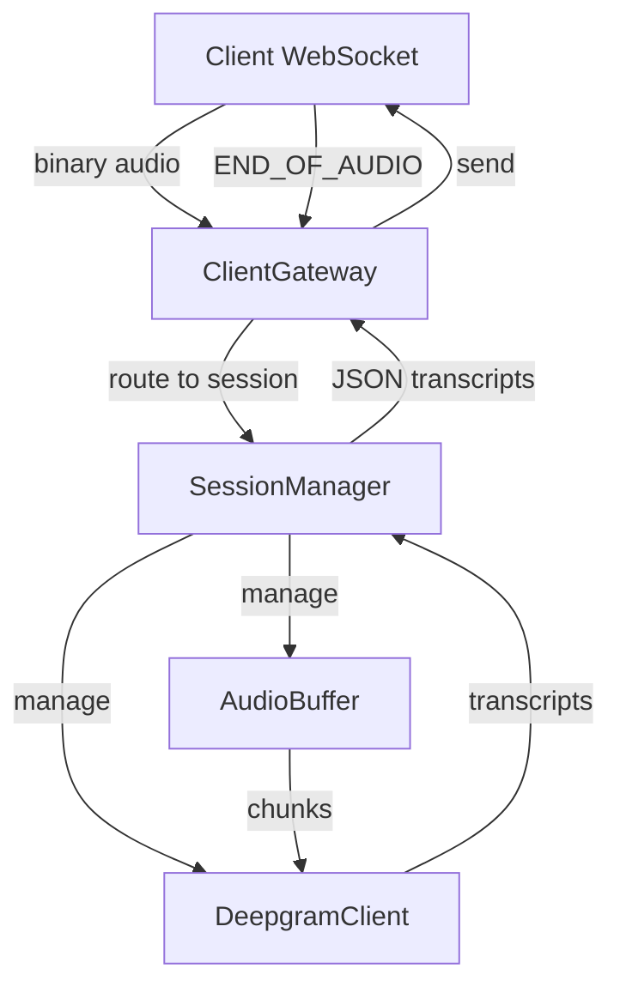
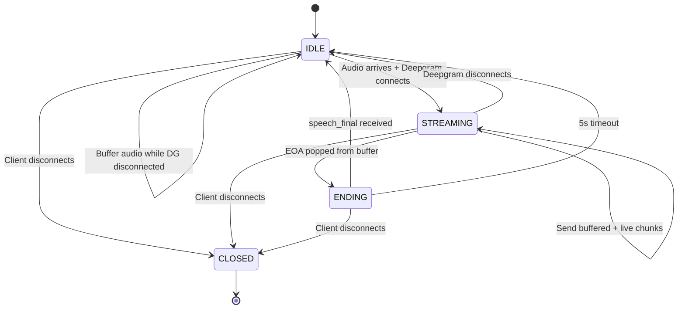

# Nimrod Refactor Plan: WebSocket → Deepgram Streaming Bridge

## Overview

Transform the monolithic [`nimrod.js`](nimrod.js:1) (~900 lines) into a composable, testable, and scalable multi-client streaming service with proper state management, buffering, and finalization handling.

## Architecture

### Directory Structure

```
nimrod/
├── config.js                    # Environment configuration
├── index.js                     # Main entry point
├── server/
│   └── ClientGateway.js         # WebSocket server & client routing
├── core/
│   ├── Types.js                 # Enums, constants, event types
│   ├── AudioBuffer.js           # Bounded queue with EOA sentinel
│   ├── DeepgramClient.js        # Deepgram connection lifecycle
│   └── SessionManager.js        # State machine & orchestration
└── utils/
    └── logger.js                # Structured logging utilities
```

### High-Level Flow



### State Machine



## Module Specifications

### 1. config.js

**Purpose**: Centralize all environment configuration with defaults.

**Exports**:
```javascript
module.exports = {
  server: {
    port: 8550,
  },
  deepgram: {
    apiKey: process.env.DEEPGRAM_API_KEY,
    url: process.env.DEEPGRAM_URL || 'wss://api.deepgram.com/v1/listen',
    model: 'nova-3',
    language: process.env.SOURCE_LANGUAGE_CODE_LOCALE || 'en-US',
    encoding: 'linear16',
    sampleRate: parseInt(process.env.SAMPLE_RATE, 10) || 16000,
    // ... other Deepgram options
  },
  session: {
    finalizeTimeoutMs: parseInt(process.env.FINALIZE_TIMEOUT_MS, 10) || 5000,
    bufferMaxChunks: parseInt(process.env.BUFFER_MAX_CHUNKS, 10) || 1000,
    connectMaxRetries: parseInt(process.env.DG_CONNECT_MAX_RETRIES, 10) || 3,
    connectBaseDelayMs: parseInt(process.env.DG_CONNECT_BASE_DELAY_MS, 10) || 1000,
  },
};
```

### 2. utils/logger.js

**Purpose**: Structured logging with consistent format.

**Key Functions**:
```javascript
// Format: [timestamp][client:id][session:id][module] message
function log(clientId, sessionId, module, level, message, metadata)
function debug(clientId, sessionId, module, message, metadata)
function info(clientId, sessionId, module, message, metadata)
function warn(clientId, sessionId, module, message, metadata)
function error(clientId, sessionId, module, message, error)
```

### 3. core/Types.js

**Purpose**: Define all enums, constants, and event types.

**Exports**:
```javascript
const SessionState = {
  IDLE: 'IDLE',
  STREAMING: 'STREAMING',
  ENDING: 'ENDING',
  CLOSED: 'CLOSED',
};

const DeepgramState = {
  DISCONNECTED: 'DISCONNECTED',
  CONNECTING: 'CONNECTING',
  CONNECTED: 'CONNECTED',
  CLOSING: 'CLOSING',
  CLOSED: 'CLOSED',
};

const AudioEventType = {
  CHUNK: 'CHUNK',
  EOA: 'EOA',
};

const ClientEventType = {
  TRANSCRIPT: 'TRANSCRIPT',
  ERROR: 'ERROR',
  FINALIZED: 'FINALIZED',
};
```

### 4. core/AudioBuffer.js

**Purpose**: Thread-safe bounded queue with EOA sentinel support.

**Class**: `AudioBuffer`

**Key Methods**:
```javascript
constructor(maxChunks = 1000)
push(chunk)              // Returns true if added, false if full
pushEOA()                // Add EOA sentinel
async pop()              // Awaitable; returns {type, data}
peek()                   // Non-blocking check
clear()                  // Empty buffer
getSize()                // Current size
isFull()                 // Check capacity
isClosed()               // Check if closed
close()                  // Mark as closed, reject pending pops
```

**Internal Structure**:
```javascript
{
  buffer: [],           // Array of {type: 'CHUNK'|'EOA', data: Buffer|null}
  maxChunks: 1000,
  resolvers: [],        // Pending pop() promises
  closed: false,
}
```

### 5. core/DeepgramClient.js

**Purpose**: Manage Deepgram WebSocket lifecycle with retry logic.

**Class**: `DeepgramClient`

**Key Methods**:
```javascript
constructor(config, clientId, sessionId)
async connect()          // Connect with exponential backoff retry
async send(chunk)        // Send audio chunk (only when CONNECTED)
finalize()              // Send finalize signal
close()                 // Close connection
getState()              // Return DeepgramState
onTranscript(callback)  // Register transcript handler
onError(callback)       // Register error handler
onClose(callback)       // Register close handler
```

**Retry Logic**:
- Exponential backoff: baseDelay * (2 ^ attempt) with jitter
- Max retries from config
- Continue buffering during retries
- Surface metrics on retry attempts

**State Transitions**:
```
DISCONNECTED --connect()--> CONNECTING --success--> CONNECTED
                                |--failure--> retry or DISCONNECTED
CONNECTED --close()--> CLOSING --> CLOSED
CONNECTED --error--> DISCONNECTED (auto-retry if configured)
```

### 6. core/SessionManager.js

**Purpose**: Orchestrate the complete session lifecycle.

**Class**: `SessionManager`

**Constructor**:
```javascript
constructor(clientId, sessionId, ws, config)
```

**Key Methods**:
```javascript
async start()                    // Initialize session
async handleAudioChunk(chunk)    // Process incoming audio
async handleEndOfAudio()         // Process EOA marker
async handleClientClose()        // Cleanup on client disconnect
getState()                       // Return SessionState
```

**Internal Orchestration**:

1. **IDLE State**:
   - Buffer incoming audio chunks
   - When first audio arrives AND Deepgram disconnected → `ensureDeepgram()`
   
2. **ensureDeepgram()**:
   - If already connected → start `sendLoop()` if not running
   - Otherwise → connect with retries → start `sendLoop()`
   - Transition to STREAMING on successful connection

3. **sendLoop()** (async loop):
   ```javascript
   while (state === STREAMING && deepgram.isConnected()) {
     const item = await buffer.pop();  // Blocks until data
     if (item.type === EOA) {
       enterEnding();
       break;
     }
     await deepgram.send(item.data);
   }
   ```

4. **STREAMING State**:
   - Drain buffered chunks first
   - Then forward live chunks as they arrive
   - On EOA marker from buffer → `enterEnding()`

5. **enterEnding()**:
   - Transition to ENDING state
   - Start 5s finalization timer
   - Wait for `speech_final: true` OR timeout
   
6. **ENDING State**:
   - On `speech_final: true` transcript → cleanup → IDLE
   - On timeout → cleanup → IDLE
   - Cleanup: close Deepgram, clear timers, emit finalized event

7. **Error Handling**:
   - Deepgram disconnect during STREAMING → return to IDLE, continue buffering
   - Connection errors → retry with backoff
   - Buffer full → apply backpressure (stop reading from client)

### 7. server/ClientGateway.js

**Purpose**: Accept client WebSocket connections and route to isolated sessions.

**Class**: `ClientGateway`

**Key Methods**:
```javascript
constructor(port, config)
start()                          // Start WebSocket server
handleConnection(ws)             // Handle new client
```

**Session Management**:
```javascript
// Map of active sessions: clientId -> SessionManager
const sessions = new Map();

// On new connection:
1. Generate unique clientId
2. Create SessionManager instance
3. Start session
4. Route ws messages to session
5. Handle ws close/error → cleanup session
```

**Message Routing**:
```javascript
ws.on('message', (data) => {
  if (isTextMessage(data) && data === 'END_OF_AUDIO') {
    session.handleEndOfAudio();
  } else if (isBinaryAudio(data)) {
    session.handleAudioChunk(data);
  }
});
```

### 8. index.js

**Purpose**: Main entry point, start the server.

```javascript
require('dotenv').config();
const config = require('./config');
const ClientGateway = require('./server/ClientGateway');
const { info } = require('./utils/logger');

const gateway = new ClientGateway(config.server.port, config);

gateway.start();
info(null, null, 'main', `Server started on port ${config.server.port}`);
```

## Key Design Decisions

### 1. State Management
- **Per-session state machine**: Each client has isolated state
- **Explicit state transitions**: All transitions logged for debugging
- **No global mutable state**: Only session registry map

### 2. Buffering Strategy
- **Bounded queue**: Prevent memory exhaustion
- **Backpressure on full**: Stop reading from client when buffer full
- **EOA as sentinel**: Special queue item, not a flag

### 3. Deepgram Lifecycle
- **Lazy connection**: Only connect when audio needs sending
- **Auto-reconnect on disconnect**: Return to IDLE, buffer continues
- **Finalization awareness**: Wait for `speech_final: true` or timeout

### 4. Concurrency
- **One writer per session**: sendLoop() is the only writer to Deepgram
- **Async/await throughout**: No callback hell
- **Non-blocking operations**: All I/O is async

### 5. Cleanup & Resource Management
- **Explicit cleanup paths**: On EOA finalization, client disconnect, error
- **Timer management**: Clear all timers on state transitions
- **Connection cleanup**: Properly close Deepgram connections

### 6. Logging Strategy
- **Comprehensive state transitions**: Log every state change
- **Debug-friendly**: Include context (buffer size, chunk count, etc.)
- **Error details**: Include stack traces and relevant state
- **Performance markers**: Log timing for critical operations

## Data Flow Example

### Scenario: Client sends audio → EOA → receives transcript

```
1. Client connects
   → ClientGateway creates SessionManager (IDLE)
   
2. Client sends audio chunk #1
   → SessionManager.handleAudioChunk()
   → AudioBuffer.push(chunk)
   → SessionManager.ensureDeepgram()
   → DeepgramClient.connect() [with retries]
   → State: IDLE → STREAMING
   → SessionManager.sendLoop() starts
   
3. sendLoop drains buffer
   → AudioBuffer.pop() → chunk #1
   → DeepgramClient.send(chunk)
   
4. Client sends audio chunks #2-10
   → AudioBuffer.push() for each
   → sendLoop continues sending
   
5. Deepgram sends interim transcripts
   → DeepgramClient emits transcript event
   → SessionManager receives transcript
   → Send JSON to client via ws
   
6. Client sends END_OF_AUDIO
   → SessionManager.handleEndOfAudio()
   → AudioBuffer.pushEOA()
   
7. sendLoop pops EOA from buffer
   → SessionManager.enterEnding()
   → State: STREAMING → ENDING
   → DeepgramClient.finalize()
   → Start 5s timeout timer
   
8. Deepgram sends final transcript (speech_final: true)
   → SessionManager receives final transcript
   → Send final JSON to client
   → Clear timeout timer
   → DeepgramClient.close()
   → State: ENDING → IDLE
   → Ready for new session on same WebSocket
```

## Migration Notes

### Breaking Changes
- **No backward compatibility required** per user request
- Client protocol remains the same:
  - Binary frames = audio chunks
  - Text frame "END_OF_AUDIO" = end marker
  - JSON responses = transcripts

### New Behaviors
- **Better buffering**: Audio won't be lost during Deepgram reconnection
- **Proper finalization**: Guaranteed wait for `speech_final: true`
- **Clean reconnection**: Sessions can restart on same WebSocket
- **Concurrent clients**: Multiple clients fully isolated

## Configuration Example

Create `.env` file:
```env
# Deepgram
DEEPGRAM_API_KEY=your_key_here
SOURCE_LANGUAGE_CODE_LOCALE=en-US
SAMPLE_RATE=16000

# Session Management
FINALIZE_TIMEOUT_MS=5000
BUFFER_MAX_CHUNKS=1000

# Retry Configuration
DG_CONNECT_MAX_RETRIES=3
DG_CONNECT_BASE_DELAY_MS=1000
```

## Testing Strategy (Manual for now)

### Test Cases
1. **Basic flow**: Single client, audio → EOA → finalize
2. **Buffering**: Send audio before Deepgram ready
3. **Finalization timeout**: EOA with no speech_final response
4. **Multiple clients**: 3+ concurrent connections
5. **Client disconnect**: During STREAMING, ENDING states
6. **Deepgram errors**: Connection failures, unexpected closes
7. **Reconnection**: Deepgram closes mid-stream

### Debug Logging
- Enable all log levels
- Watch state transitions
- Monitor buffer sizes
- Track timing metrics

## Implementation Order

Follow the todo list sequence:
1. Create directory structure
2. Build from bottom up: config → logger → Types → AudioBuffer
3. Then DeepgramClient (can test in isolation)
4. Then SessionManager (orchestrates buffer + client)
5. Then ClientGateway (wires everything together)
6. Finally update index.js and test end-to-end

## Success Criteria

✅ Multiple clients can connect simultaneously without interference
✅ Audio buffering works when Deepgram isn't ready
✅ EOA properly triggers finalization with timeout
✅ speech_final transcripts properly close Deepgram
✅ Client disconnects properly cleanup resources
✅ Reconnection works after Deepgram disconnect
✅ Comprehensive logging aids debugging
✅ Code is modular, testable, and maintainable

---

**Note**: This refactor prioritizes correctness, debuggability, and maintainability over premature optimization. Performance tuning can come later once the core architecture is solid.